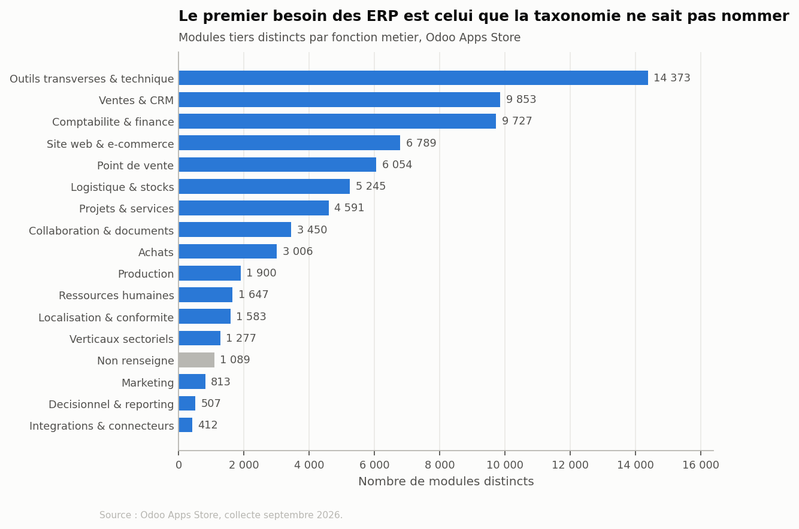
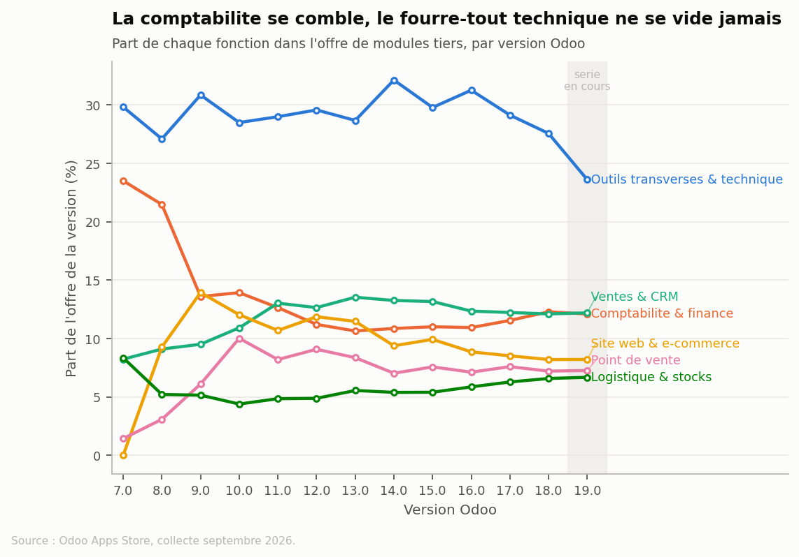

# Cartographier les manques des ERP

Un module tiers n'existe que pour une raison : quelqu'un a payé un développeur
parce que le progiciel standard ne répondait pas à son besoin. Chaque module
publié est donc la trace d'un manque, et leur distribution dessine en creux une
carte de ce que les ERP ne couvrent pas.

Ce dépôt collecte l'intégralité de l'Odoo Apps Store et en tire cette carte.

## Résultat principal

Sur 72 316 modules tiers, la fonction qui en concentre le plus n'est pas une
fonction métier. C'est la rubrique fourre-tout des outils techniques, avec
19,9 % du catalogue. L'analyse lexicale des résumés montre ce qu'elle contient :
masquer un bouton, restreindre un accès, tracer une modification, importer un
fichier. Le premier manque des ERP n'est pas fonctionnel, il est adaptatif.



Deux autres résultats ressortent de l'analyse par version.

La comptabilité représentait 23,5 % de l'offre en version 7.0. Elle n'en
représente plus que 12,3 % en 18.0 : l'éditeur a absorbé une large part du
besoin au fil des versions.

La rubrique technique, elle, reste comprise entre 27 et 32 % de l'offre sur
douze versions consécutives. Ce n'est ni un oubli ni un retard, c'est un manque
structurel.



## Le corpus en bref

| | |
|---|---:|
| Modules distincts | 72 316 |
| Lignes (module × version) | 72 579 |
| Éditeurs, après normalisation des noms | 6 437 |
| Catégories du site | 111 |
| Fonctions métier du référentiel | 17 |
| Versions Odoo couvertes | 5.0 à 19.0 |
| Modules gratuits | 30,4 % |
| Prix médian d'un module payant | 39 € |

La répartition par fonction : outils transverses et technique 19,9 %, ventes et
CRM 13,6 %, comptabilité et finance 13,5 %, site web et commerce électronique
9,4 %, point de vente 8,4 %.

Le marché est celui d'artisans plutôt que d'une industrie. L'indice de
Herfindahl s'établit à 57 points sur 10 000, le plus gros éditeur ne pèse que
3,5 % du catalogue, et 47 % des éditeurs n'ont publié qu'un seul module.

La contrainte locale ou réglementaire touche 7,4 % des modules, contre 2,2 %
pour la seule rubrique « Localisation » du site. Elle traverse la comptabilité,
la facturation, le point de vente et la paie : ce n'est pas un module, c'est une
dimension.

## Méthode

**Source.** L'Odoo Apps Store, consulté en septembre 2026. Périmètre exhaustif :
111 catégories, versions 5.0 à 19.0, modules gratuits et payants.

**Unité d'observation.** Le couple (module, version Odoo), dédoublonné des
appartenances multiples : 72 579 lignes pour 72 316 modules distincts. Les
catégories du site se recoupent, 23,4 % des modules relèvent de plusieurs
d'entre elles, et jusqu'à treize pour l'un.

**Deux vues, deux mesures.** La liste non filtrée n'affiche chaque module qu'une
fois, à sa version la plus récente : 55 % du corpus y apparaît en 19.0. Elle
décrit la fraîcheur du catalogue, pas sa couverture par version. L'axe temporel
vient donc du filtre `?series=`, qui recense les modules disponibles pour chaque
version : 277 538 disponibilités, contre 72 579 lignes dans le corpus.

**Référentiel fonctionnel.** La taxonomie du site n'a pas été conçue pour
l'analyse : quasi-doublons (`Purchase` et `Purchases`, `Inventory` et
`Warehouse`, `Localization` et `Localisation`), rubriques fourre-tout, et
catégories de trois modules. Les 111 catégories sont donc regroupées en 17
fonctions métier. Cette table est une interprétation ; elle est versionnée comme
une donnée, dans `data/processed/category_mapping.csv`, pour pouvoir être relue
et modifiée.

## La liste des catégories a dû être reconstituée

La page d'accueil de l'Apps Store affiche 18 catégories. La somme de leurs
effectifs ne représente que 68 % du total annoncé par le site : un tiers du
catalogue est rangé dans des catégories qui ne sont affichées nulle part. Parmi
elles, `Tools`, la plus grosse du site avec 12 210 modules.

Le notebook de collecte sonde 122 noms candidats, tirés des catégories standard
d'Odoo, et en retient 111 non vides. La liste est vérifiée par comparaison des
totaux : 90 774 contre 90 848 annoncés, soit un résidu non attribué de 74
modules (0,08 %). Ces deux nombres comptent des appartenances et non des
modules, puisque les catégories se recoupent.

## Reproduire

```bash
python -m venv .venv && source .venv/bin/activate
pip install -r requirements.txt
jupyter lab
```

Puis les trois notebooks dans l'ordre. Ils sont autonomes : tout le code y
figure, il n'y a aucun module à importer.

| Notebook | Contenu | Durée |
|---|---|---|
| `01_collecte.ipynb` | robots.txt, catégories, recensement, fiches | environ 2 h |
| `02_nettoyage.ipynb` | nettoyage, référentiel, dictionnaire des données | moins d'une minute |
| `03_analyse.ipynb` | analyses et cinq figures | moins d'une minute |

La collecte met chaque page en cache sur disque et journalise les pages
traitées. Elle peut être interrompue et reprise sans rien retélécharger.

## Conditions de collecte

Le `robots.txt` d'`apps.odoo.com` a été lu avant d'écrire la première requête,
et vérifié le 21 septembre 2026. Trois règles concernent le parcours des
modules : `Disallow: */page/*/*`, `Disallow: *?*page=` et `Disallow: *?*order=`.

Les URL employées sont de la forme
`/apps/modules/category/<catégorie>/browse/page/<n>`. La pagination y est un
segment terminal, sans segment suivant : elle ne relève donc pas du premier
motif. Aucun paramètre `page=` ni `order=` n'est utilisé.

Aucun `Crawl-delay` n'est déclaré. Le collecteur s'impose malgré tout 1,5
seconde entre deux requêtes, augmentées d'un délai aléatoire, avec repli
exponentiel en cas d'erreur serveur. Le `User-Agent` identifie le projet et
donne une adresse de contact.

Seules des données publiques sont collectées : aucune page nécessitant un
compte, aucune donnée personnelle au-delà du nom commercial de l'éditeur.

## Limites

Le nombre de modules ne mesure pas directement un manque. Une fonction dense
peut refléter un besoin non couvert, un besoin trop spécifique pour être
standardisé, ou une rubrique où il est simplement facile de publier.

Une part qui recule n'est pas un effectif qui recule. Sept fonctions voient leur
part baisser alors que leur volume augmente : le reste du catalogue a grossi
plus vite.

Le corpus décrit l'offre à la date de collecte, pas l'histoire des
publications : un module retiré du store est invisible, ce qui sous-estime les
versions anciennes dans une proportion qu'on ne peut pas chiffrer.

La catégorie est déclarée par l'éditeur, avec ce que cela suppose d'optimisation
pour la visibilité. La détection du caractère local, réglementaire ou sectoriel
repose sur des mots-clés, avec faux positifs et faux négatifs : ce sont des
ordres de grandeur, pas des mesures.

Les compteurs d'usage ne sont pas homogènes : téléchargements pour les modules
gratuits, achats pour les payants. Ils sont stockés dans deux colonnes distinctes
et ne sont jamais additionnés. La note moyenne, la licence et la date de
publication ne figurent pas sur les cartes de liste et n'ont pas été collectées.

En retirant les 20 plus gros éditeurs, soit 27 % du corpus, le classement des
fonctions reste inchangé : la corrélation des rangs de Spearman est de 0,984. La
carte ne reflète donc pas des stratégies de catalogue.

## Contenu du dépôt

```
notebooks/
  01_collecte.ipynb          robots.txt, catégories, recensement, fiches
  02_nettoyage.ipynb         nettoyage, référentiel, dictionnaire
  03_analyse.ipynb           analyses et figures
data/
  raw/                       non versionné, régénéré par le notebook 01
  processed/
    categories.csv           les 111 catégories du site et leurs effectifs
    category_mapping.csv     correspondance vers les 17 fonctions métier
    dictionnaire_donnees.md  description de chaque colonne du corpus
dashboard/index.html         tableau de bord interactif, page autonome
figures/                     les cinq figures, en PDF vectoriel et en PNG
paper/main.tex               le document, 12 pages
```

Le corpus nettoyé (`data/processed/modules_clean.csv`, environ 70 Mo) n'est pas
versionné. Il se régénère intégralement depuis les notebooks 01 et 02.

## Compiler le document

```bash
cd paper && tectonic main.tex
```

[Tectonic](https://tectonic-typesetting.github.io/) télécharge lui-même les
paquets nécessaires. La bibliographie utilise `bibtex` et non `biber` : Tectonic
embarque le premier, le second demanderait une installation séparée.

## Licence

Code sous licence MIT. Les données collectées restent la propriété de leurs
éditeurs respectifs et ne sont redistribuées que sous forme agrégée.
